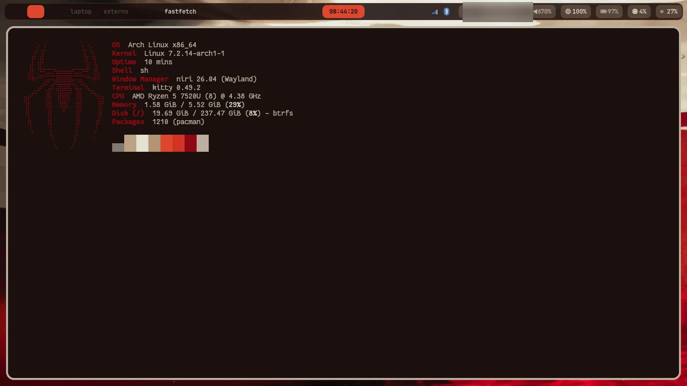
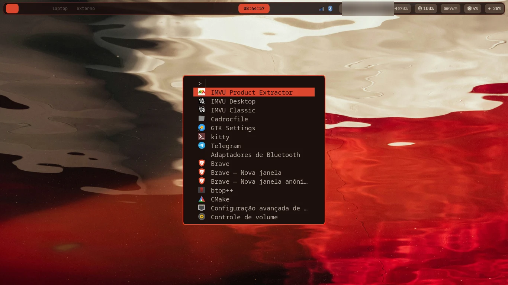
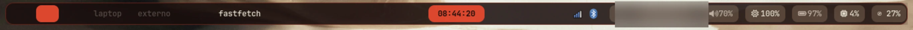

# niri-dotfiles

Configuração do compositor Wayland **niri** no **Arch Linux puro (rolling)** e
scripts de apoio (wal, wallpapers, notificações, etc.), sincronizados em um
repositório git.

## Capturas de tela

> Informações pessoais (nome de usuário, hostname e nome da rede Wi-Fi) foram
> desfocadas nas imagens.

| Desktop | Launcher |
|:---:|:---:|
| [](docs/screenshots/desktop.webp) | [](docs/screenshots/launcher.webp) |

### Waybar

[](docs/screenshots/waybar.webp)

## Estrutura

```
niri-dotfiles/
├── install.sh              # Instala pacotes das listas (official + AUR)
├── deploy.sh               # Copia configs/scripts do repo para ~/.config (sem symlinks)
├── check.sh                # Valida sintaxe dos scripts (.sh)
├── lista_pacman.txt        # Pacotes oficiais explícitos (pacman -Qenq)
├── lista_aur.txt           # Pacotes do AUR explícitos (pacman -Qemq)
├── servicos.txt            # Serviços systemd a habilitar
├── docs/screenshots/       # Capturas de tela usadas no README
└── .config/
    ├── niri/               # Config do niri (config, binds, layout, animações)
    │   └── scripts/        # Scripts exclusivos do niri (ex.: niri-keys.sh)
    ├── scripts/            # Scripts compartilhados (lock, record, wallpaper, ...)
    │   ├── colors/         # Geradores de cor por aplicativo
    │   └── wallpapers/     # Geradores de wallpaper reproduzíveis
    ├── wallpapers/         # Wallpapers versionados (default-dark.png)
    ├── cava/               # Config, temas e shaders do visualizador de áudio
    ├── fastfetch/          # config.jsonc e ascii.txt
    ├── fuzzel/             # Launcher (config + cores geradas)
    ├── kitty/              # Terminal (config + cores geradas)
    ├── swaylock/           # Tela de bloqueio (config + cores geradas)
    ├── swaync/             # Notificações (cores geradas)
    ├── waybar/             # Barra (config, style e cores geradas)
    └── zathura/            # Leitor de PDF (config + cores geradas)
```

### Organização dos scripts

Os scripts ficam versionados no repositório e são copiados para `~/.config`
pelo `deploy.sh` (sem symlinks):

- **`.config/scripts/`** — scripts compartilhados entre window managers (lock,
  record, wallpaper, clipboard, cores, etc.). Após o deploy, o diretório entra
  no `PATH` pelo `~/.bashrc`.
- **`.config/niri/scripts/`** — apenas o que depende do niri (lê `binds.kdl`,
  chama `niri msg`, etc.).
- **`~/.local/bin/`** — somente binários e ferramentas pessoais (`ruwall`,
  `imvu-extractor`, scripts de estilo), nunca cópias de scripts versionados.

Para outro window manager, crie `~/.config/<wm>/scripts/` só com o que for
exclusivo dele e reutilize `~/.config/scripts/` para o resto. Os binds devem
apontar sempre para o caminho canônico (`$HOME/.config/scripts/...`).

### Deploy e sincronização

O `deploy.sh` copia os arquivos (sem symlinks). O sentido padrão é
repositório → `~/.config`:

```sh
./deploy.sh              # copia e faz backup do que for substituído
./deploy.sh --dry-run    # mostra o que mudaria, sem alterar nada
./deploy.sh --generate   # depois de copiar, regenera as cores do tema atual
./deploy.sh --prune      # remove arquivos que saíram do repo (wallpapers nunca)
```

Para o sentido inverso, capture o que mudou direto em `~/.config`:

```sh
./deploy.sh --pull       # ~/.config -> repo (só o default-dark.png nos wallpapers)
git diff                 # revise
git add -A && git commit -m "..."
```

Backups dos arquivos substituídos ou removidos ficam em
`~/.cache/niri-dotfiles/backups/<timestamp>/`.

## Restauração em uma máquina nova

Pré-requisitos: **Arch Linux puro (rolling)** instalado, usuário com `sudo` e
rede funcionando. Antes de rodar o `install.sh`, garanta as ferramentas básicas
de build e sincronização:

```sh
sudo pacman -S --needed base-devel git curl rsync
```

Depois clone o repositório e rode a instalação:

```sh
# 1. Clone e instale os pacotes (primeira execução como usuário comum)
git clone <url-do-repo> ~/niri-dotfiles
cd ~/niri-dotfiles
./install.sh              # instala todos os pacotes (oficial + AUR)
./install.sh --services   # habilita serviços de servicos.txt (bluetooth, NM, etc.)

# 2. Deploy das configurações por cópia (backup do que for substituído)
./deploy.sh
./deploy.sh --generate    # opcional: gera as cores a partir do wallpaper atual

# 3. Dependência local: ruwall (binário, não é pacote)
#    Baixe o binário do ruwall e coloque em $HOME/.local/bin/ruwall
#    (usado pelo random-wallpaper.sh)
```

> Serviços específicos da máquina (ex.: `seatd.service`, `ollama.service`) podem
> ser removidos de `servicos.txt` se não fizerem sentido no destino.

Depois da instalação:

```sh
# Wallpaper inicial (gera o tema wal) e regeneração dos esquemas de cor
ruwall -i "$HOME/.config/wallpapers/algum_wallpaper.png"
~/.config/scripts/run-scripts.sh    # gera cores para niri, waybar, etc.
```

## Atualizando as listas de pacotes

Quando instalar/remover pacotes explicitamente, regenere as listas e commite:

```sh
./install.sh --update-lists     # regenera lista_pacman.txt e lista_aur.txt
git add lista_*.txt && git commit -s -m "Atualizar lista de pacotes"
```

## Validação

```sh
./check.sh               # sh -n / bash -n em todos os scripts
./check.sh --shellcheck  # também roda shellcheck (se instalado)
```

## Notas

- **`layout.kdl`** é gerado a partir das cores do wal pelo
  `scripts/colors/niri-colors.sh` (executado via `run-scripts.sh` no startup e no
  `Mod+G`). A versão versionada serve de fallback para máquinas novas antes do
  primeiro `ruwall`; depois ela é sobrescrita com as cores do wallpaper atual.
- **Configurações dos apps de aparência** (`cava`, `fastfetch`, `fuzzel`,
  `kitty`, `swaylock`, `swaync`, `waybar` e `zathura`) são versionadas em
  `.config/<app>`. Os arquivos de cor (`colors-*`, `cava/themes/colors`,
  `zathurarc`, `swaylock/config`) são **gerados** pelos scripts em
  `scripts/colors/` a partir do wallpaper, mas ficam no repositório como
  fallback para o primeiro boot. Eles são sobrescritos pelo `run-scripts.sh`; se
  quiser manter o tema atual, commite as mudanças depois de trocar o wallpaper.
- **Wallpaper padrão**: `~/.config/wallpapers/default-dark.png` é versionado no
  repositório. Para regerá-lo (requer ImageMagick):

  ```sh
  ~/.config/scripts/wallpapers/default-dark.sh
  ~/.config/scripts/run-scripts.sh ~/.config/wallpapers/default-dark.png
  ```

  O segundo comando atualiza a paleta do wal/ruwall e as cores dos apps.
- **`random-wallpaper.sh` (Mod+H)**: percorre todos os wallpapers da pasta antes
  de repetir qualquer um (ciclo persistido em
  `~/.cache/wallpapers/wallpaper_cycle.txt`). Com um único wallpaper, ele apenas
  reaplica esse mesmo arquivo.
- O `deploy.sh` copia os arquivos para `$HOME/.config` (não usa symlinks) e
  guarda backups dos arquivos substituídos em
  `~/.cache/niri-dotfiles/backups/<timestamp>/`. Para capturar mudanças feitas
  direto em `~/.config`, rode `./deploy.sh --pull`, revise com `git diff` e
  commite.

## cadrocfile (gerenciador de arquivos)

O [cadrocfile](https://github.com/souandresouza/cadrocfile) é o meu gerenciador de arquivos GTK4 + Libadwaita. 

Ele já está mapeado no `binds.kdl` com:

```kdl
Mod+E { spawn "cadrocfile"; }
```

### Instalação

O próprio repositório `cadrocfile` já tem um instalador bem completo (`install.sh`), que baixa binário pré-compilado quando possível ou compila a partir do código.

#### Opção 1: Pelo install.sh do niri-dotfiles (recomendado)

```sh
cd ~/niri-dotfiles
./install.sh --cadrocfile
```

Ele vai clonar/usar `~/cadrocfile`, rodar o instalador dele e colocar o binário em `~/.local/bin/` (ou `/usr/local/bin/` caso rode com privilégios necessários).

#### Opção 2: Manual

```sh
# Clonar (se ainda não tiver)
git clone https://github.com/souandresouza/cadrocfile ~/cadrocfile
cd ~/cadrocfile

# Instalar (detecta distro, instala deps, baixa binário ou compila)
./install.sh
```

### Configuração

As configurações ficam em `~/.config/cadrocfile/`. O instalador **não** sobrescreve nada que já exista lá.

### Dica

Garanta que `~/.local/bin` está no seu `$PATH`. Em muitas distros já vem, mas caso não venha, adicione ao seu `.bashrc`/`.zshrc`:

```sh
export PATH="$HOME/.local/bin:$PATH"
```


## ruwall (gerador de paleta de cores)

O [ruwall](https://github.com/souandresouza/ruwall) é um port em Rust do `pywal`. Ele gera uma paleta de cores a partir do wallpaper e aplica em vários aplicativos (waybar, kitty, fuzzel, niri etc.).

É usado pelos scripts do repositório, principalmente pelo `random-wallpaper.sh`, para manter o tema dinâmico conforme o wallpaper.

### Instalação

#### Opção 1: Pelo install.sh do niri-dotfiles (recomendado)

```sh
cd ~/niri-dotfiles
./install.sh --ruwall
```

Ele vai clonar/usar `~/ruwall`, compilar com `cargo build --release` e instalar o binário em `~/.local/bin/ruwall`.

#### Opção 2: Manual

```sh
# Clonar (se ainda não tiver)
git clone https://github.com/souandresouza/ruwall ~/ruwall
cd ~/ruwall

# Compilar e instalar
cargo build --release
install -m755 target/release/ruwall ~/.local/bin/ruwall
```

### Requisitos

- `rustup` / toolchain Rust funcional
- `base-devel` já vem nas listas do `install.sh`

### Uso básico

```sh
# Gerar cores a partir de um wallpaper
ruwall -i ~/Imagens/wallpapers/meu-wallpaper.jpg

# Restaurar último esquema
ruwall -R

# Usar tema pré-definido
ruwall -f base16-monokai
```

> Os caches ficam em `~/.cache/wal/` (`colors.json`, `colors.sh`, etc), no mesmo padrão do pywal.

## Arch Linux puro (rolling)

Este repositório é pensado e testado no **[Arch Linux](https://archlinux.org/)
puro (rolling)** com [Niri](https://github.com/YaLTeR/niri). Não há dependência
de meta-pacotes de distros derivadas.

As listas `lista_pacman.txt` e `lista_aur.txt` são geradas a partir dos
**pacotes explícitos** instalados na minha máquina (`pacman -Qenq` e
`pacman -Qemq`). Ou seja, **refletem exatamente o meu setup atual**, não um
"mínimo funcional".

Se você quer **reproduzir exatamente a minha configuração**, use Arch Linux e
rode o `install.sh` completo. Uma instalação base feita com `archinstall` já
atende aos pré-requisitos; o restante vem das listas.

O `install.sh` verifica as dependências de build/AUR (`base-devel`, `git`,
`curl`), instala o helper AUR (`yay-bin`) quando necessário e tenta ser
resiliente. O `deploy.sh` usa `rsync`, que também está na lista de pacotes.
Caso algo falhe, compare as listas com o seu sistema e instale manualmente os
pacotes que faltarem.
